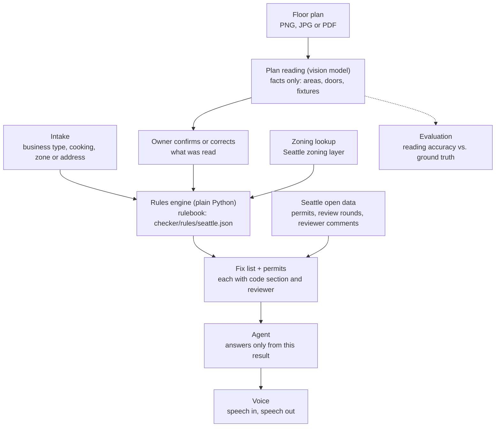

<h1 align="center">Seattle Permit Pre-Check</h1>

<p align="center">
  <b>Can a small-business owner find out what the city's plan reviewer will send back, before they submit?</b><br>
  Upload a floor plan for a café, bar, shop, salon, office or gym in Seattle. Get the fix list, the permits to expect, and what Seattle's own review records say about projects like yours. Ask questions by typing or by voice.
</p>

<p align="center">
  
  
  
  <a href="LICENSE"></a>
</p>

> **Status: prototype.** The rules, the Seattle data pipeline and the website run and are tested. Three things have **not** been run against the real services yet: the vision model on a plan, the live Seattle download, and the two local speech models. The [status table](#what-is-real-and-what-is-not-yet) says exactly what is real. This is a pre-submission check, not a code determination, and it is not affiliated with the City of Seattle.

## Contents

- [What it does](#what-it-does)
- [What is real and what is not yet](#what-is-real-and-what-is-not-yet)
- [Try it](#try-it)
- [How it works](#how-it-works)
- [Repository map](#repository-map)
- [Websites and keys](#websites-and-keys)
- [What Seattle's data showed](#what-seattles-data-showed)
- [Build phases](#build-phases)
- [Working in this repo](#working-in-this-repo)
- [Limits](#limits)
- [Troubleshooting](#troubleshooting)
- [Team](#team)

## What it does

Opening a small business in Seattle means a construction permit, and most plans do not pass the first time: of 529 restaurant-related tenant build-outs since 2019 that went through plan review, 87% needed two or more rounds ([details](#what-seattles-data-showed)). Each round is weeks of rent with no revenue. This prototype:

- **reads the floor plan** with a vision model, which only reports facts (areas, door widths, fixtures) and never judges them,
- **shows what it read** so the owner can correct a misread number before anything is checked,
- **applies coded rules** from the Seattle Building Code for six kinds of business, so every problem traces to one line of a rulebook and one code section,
- **names who catches each problem** in Seattle's review (building-code review, zoning, Fire Department, Public Health),
- **lists the permits and agencies** for that kind of business,
- **quotes Seattle's own review records** for similar projects: rounds, days, and what reviewers comment on,
- **answers questions, typed or spoken**, using only the owner's result.

## What is real and what is not yet

| Part | File | Now | Still to do |
| --- | --- | --- | --- |
| Rulebook | `checker/rules/seattle.json` | **Real.** Six business types. Most numbers checked against the 2021 Seattle Building Code PDFs | Check the items listed in [docs/rulebook.md](docs/rulebook.md) |
| Rules engine | `checker/rules_engine.py` | **Real and tested** on three demo plans and on each business type | More checks (travel distance, parking, signage) |
| Zoning | `checker/zoning.py` | Logic tested; the live lookup is tested with the network mocked | Run one real address |
| Plan reading | `checker/extract.py` | Request tested with the API mocked | **Run it on the demo plans with a key** |
| Site photo notes | `checker/photos.py` | Up to four photos; notes whether six things are visible (exit sign, extinguisher, entrance step, sprinkler heads, kitchen hood, grab bars). Notes to confirm, never findings. Request and reply handling tested with the API mocked | **Run it on real photos with a key** |
| Evaluation | `evaluation/evaluate_extraction.py` | Scoring is real and tested | **No results yet**: run `--vision` |
| Seattle data | `pipeline/` | Mappers tested on real records; queries tested on a small sample | **Run the live download once** |
| Agent | `checker/agent.py` | Template answers work with no key; model path and grounding check tested with the API mocked | Try it with a key |
| Voice | `checker/voice.py` | Browser voice and fallbacks tested | **faster-whisper and Kokoro have not been run** |
| Website | `app/` | **Real.** All five pages, tested headlessly and in a browser | Deploy to a public URL |
| Permit form pre-fill | not built | | Phase 7 |

Unfinished parts say `STATUS:` in their docstring. `grep -rn "STATUS:" checker pipeline evaluation` lists them.

## Try it

Python 3.12 or newer, from the repository root:

```bash
python3 -m venv .venv
source .venv/bin/activate            # Windows (PowerShell): .venv\Scripts\Activate.ps1
python -m pip install -r requirements.txt
```

**Run the website** (works with no key and no internet, on the demo plans):

```bash
python -m streamlit run app/streamlit_app.py
```

Pick a demo plan, press **Read the plan**, then **Run the check**. Start with *Café with planted problems*, then switch to the salon to see a different business type.

**Run the tests:**

```bash
python -m pytest
```

**Download Seattle's review records** (internet, no key, a few minutes). After this, reports and the data page show real numbers:

```bash
python -m pipeline.run_pipeline --seattle
```

**Read a plan with the vision model** (needs a key: copy `.env.example` to `.env` and fill in `ANTHROPIC_API_KEY`):

```bash
python -m evaluation.evaluate_extraction --vision      # scores the model on all three demo plans
python -m checker.audit demo/flawed_plan.png --business cafe_restaurant --cooking --zoning "NC2-55 (M)"
```

**Turn on spoken questions** (optional, large download):

```bash
python -m pip install -r requirements-voice.txt
python -m checker.voice
```

Without it, questions are typed and the browser reads the answers aloud.

## How it works



Three ideas hold it together:

- **The model reads; code decides.** A language model is good at reading a drawing and bad at being consistently right about code numbers. So the model extracts facts into a fixed format, and compliance is decided by rules you can read in one JSON file.
- **Show the reading.** The owner sees what was read and can fix it. The check uses those numbers, not the drawing.
- **The agent is grounded, not trained.** Nothing here is fine-tuned. The agent is given the owner's result (and, once the data is downloaded, real reviewer comments on the same code chapters) and must answer from that. An answer that cites a rule or code section the result does not contain is discarded and replaced by a fixed template.

## Repository map

```
checker/                  the engine
├── rules/seattle.json    the rulebook: six business types, code numbers, zones, permits (start here)
├── extract.py            vision: floor plan -> facts (the only place a model reads the drawing)
├── rules_engine.py       facts + rulebook -> findings and permits (no model)
├── zoning.py             address or zone -> allowed, needs review, or not allowed, per business type
├── audit.py              runs the steps above in order; also the command-line tool
├── agent.py              answers questions about one result, with a grounding check
└── voice.py              speech to text and text to speech around the agent
pipeline/                 Seattle open data
├── seattle.py            download and map permits, plan reviews, reviewer comments
├── classify.py           sorts permits into food_drink, salon, fitness, retail by keyword
├── db.py  schema.py      SQLite storage (data/permits.sqlite)
├── query.py              rounds, days, who sends plans back, what comments are about
└── run_pipeline.py       command-line runner
app/                      the Streamlit website
├── streamlit_app.py      entrypoint: header and navigation
├── app_common.py         page paths, session keys, cached loads, Limits and About text
└── pages_app/            check (the main page), seattle_data, evidence, limits, about
evaluation/               evaluate_extraction.py: how accurately the model reads a plan
demo/                     three fictional plans, their ground truth, cases.json, make_plans.py
data/raw/                 downloads go here (not committed)
reports/                  evaluation output for the slides
docs/                     rulebook status, data sources, demo script, voice options
tests/                    one file per part, plus a headless test of the website
CLAUDE.md                 project rules for Claude Code
```

## Websites and keys

Only one key is needed, and only for reading uploaded plans and for model-written answers. Full list with what each is used for: [docs/data_sources.md](docs/data_sources.md).

| Service | Host | Key? |
| --- | --- | --- |
| Claude API (plan reading, agent) | `api.anthropic.com` | **Yes**: `ANTHROPIC_API_KEY` |
| Seattle open data (permits, reviews, comments) | `cos-data.seattle.gov` | No. Optional free app token |
| Seattle zoning layer | `services.arcgis.com` | No |
| US Census geocoder (address to point) | `geocoding.geo.census.gov` | No |
| Speech models, optional | `huggingface.co` | No (public models) |

## What Seattle's data showed

Queried directly from the city's portal on 20 November 2026, using its text search for "restaurant". The pipeline's own numbers will differ a little; use those in a pitch once it has run.

- Of 529 restaurant-related alteration permits applied for since 2019 that went through plan review, 67 (13%) passed in one round and 462 (87%) needed two or more.
- In round 1 the building-code review sent back most of them (Ordinance: 153 sent back, 24 approved). Zoning and Fire approved most (Zoning: 406 approved, 188 sent back).
- One real case, permit 6998648-CN: an office converted to a coffee shop, a $60,000 project, spent 175 days in plan review over three rounds, 77 of them waiting on the applicant's corrections.
- The reviewer-comments dataset is a sample: about 26,300 comments on 707 permits, 2022 to 2025.

## Build phases

- [x] **Phase 0: Setup.** Layout, environment, `.gitignore`, `CLAUDE.md`, tests on GitHub
- [x] **Phase 1: Rules.** Rulebook for six business types, rules engine, zoning, three demo plans
- [x] **Phase 2: Seattle data.** Download, database, queries (live download still to run)
- [x] **Phase 3: Website.** Five pages, editable reading, results, download
- [ ] **Phase 4: Plan reading with the model.** Run `--vision`, record the accuracy table, fix the prompt where it misreads
- [ ] **Phase 5: Agent and voice with real models.** Try the agent with a key; try the two speech models
- [ ] **Phase 6: More plans.** A retail and a gym demo plan, and one real (permission given) plan
- [ ] **Phase 7: Permit form pre-fill.** Fill SDCI's application fields from the result
- [ ] **Phase 8: Demo and write-up.** Results table, limits, slides ([docs/demo_script.md](docs/demo_script.md))

Phase 4 is the evidence judges will ask for. If time runs short, cut from the bottom.

## Working in this repo

- **One branch per phase or part**, merged through a pull request. The template has a short checklist.
- **The rulebook is the source of truth.** Change a number in `checker/rules/seattle.json`, never in Python. Say where the number came from in `_meta`.
- **The app holds no rules.** It calls `checker/` and `pipeline/` and displays what comes back.
- **Tests pass before merging.** `python -m pytest` locally; GitHub runs the same on every pull request.
- **Keys go in `.env`**, never in code. `.env.example` lists the names.
- **Any number you report says what data it came from.**
- **No real floor plans or personal data in the repository.** The demo plans are invented.

## Limits

- **Not a code determination.** A licensed design professional and the plan reviewer decide what complies.
- **A short list of checks.** Occupant load, exits, doors, aisles, restrooms, sprinklers, kitchen hood and sinks, zoning. A real review covers far more.
- **Seattle only**, 2021 Seattle codes. The 2024 editions arrive no sooner than May 2027.
- **Part of the rulebook is unverified.** See [docs/rulebook.md](docs/rulebook.md).
- **Demo plans are fictional** and drawn to be easy to read. Real drawings are harder, and reading accuracy on them is unknown.
- **The permit categories are keyword matches** on the city's descriptions, so some permits are missed or mislabelled.
- **Reviewer names are in the city's data and are not stored.**

## Troubleshooting

<details>
<summary><b><code>No module named 'checker'</code> (or <code>'app'</code>, <code>'pipeline'</code>)</b></summary>

Run every command from the repository root. From anywhere else, Python cannot find the packages.

</details>

<details>
<summary><b>The Seattle download fails or stops part-way</b></summary>

Run it again: finished files are kept and skipped. If the portal throttles you, get a free app token at data.seattle.gov and put it in `.env` as `SEATTLE_APP_TOKEN`. To force a fresh download add `--refresh`.

</details>

<details>
<summary><b>No sound when the agent answers</b></summary>

Press <b>Play answer</b> under the answer: some browsers block speech that a click did not start. The browser voice needs Chrome, Edge or Safari.

</details>

<details>
<summary><b>The microphone box does not appear</b></summary>

It appears only when `faster-whisper` is installed (`requirements-voice.txt`). The first recording downloads the speech model, which takes a minute.

</details>

## Team

| Name | GitHub | Owns |
| --- | --- | --- |
| Lorenzo | [RenzoRamirez26](https://github.com/RenzoRamirez26) | to be assigned |
| Maria Gomez Jacome | [cjgomez14](https://github.com/cjgomez14) | to be assigned |
| Orlando Hernandez | [Orlando-Hernandez](https://github.com/Orlando-Hernandez) | to be assigned |
| Alba Benedito | [albabc2020-hub](https://github.com/albabc2020-hub) | to be assigned |

<p align="right"><a href="#seattle-permit-pre-check">back to top ↑</a></p>
