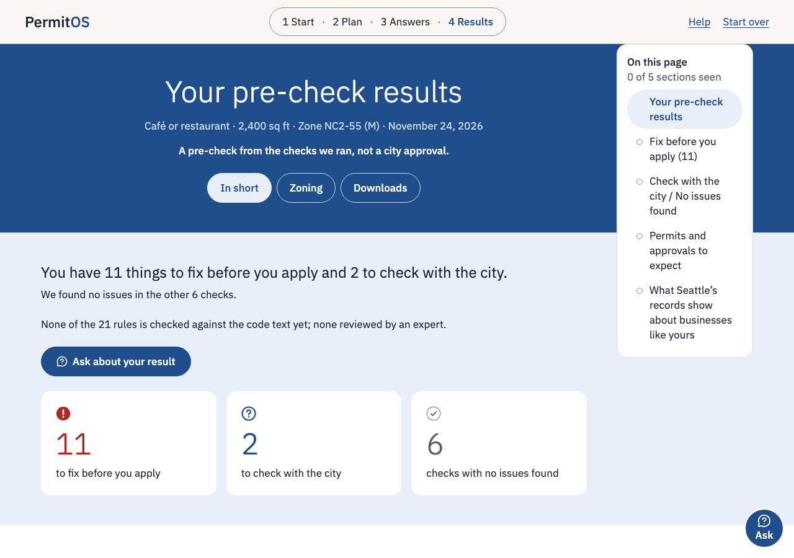
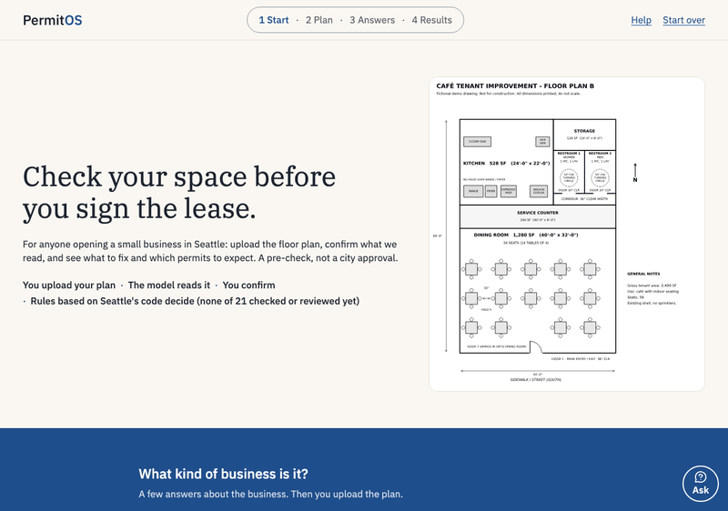
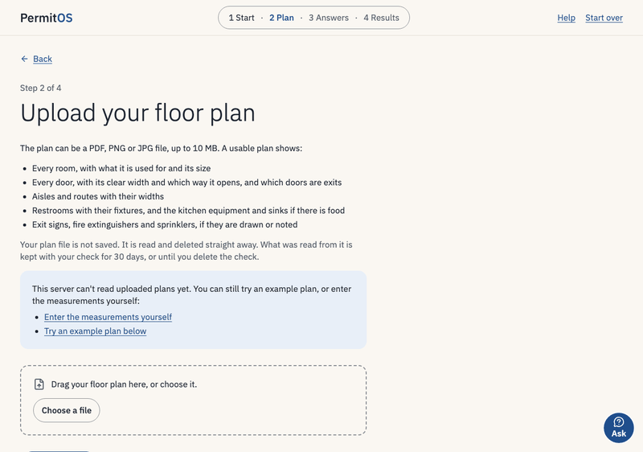
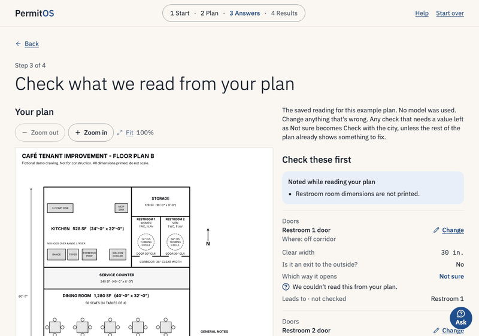
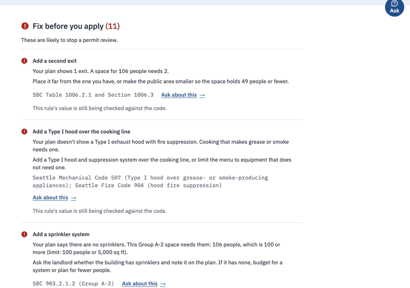
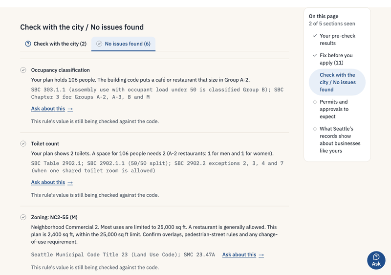
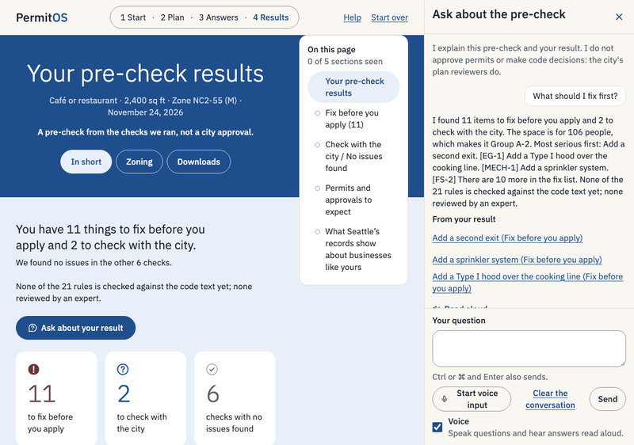
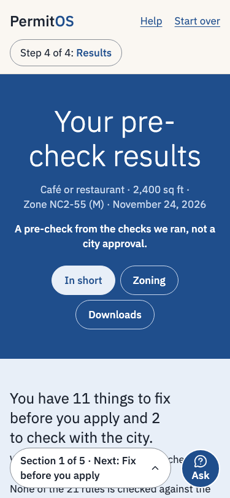
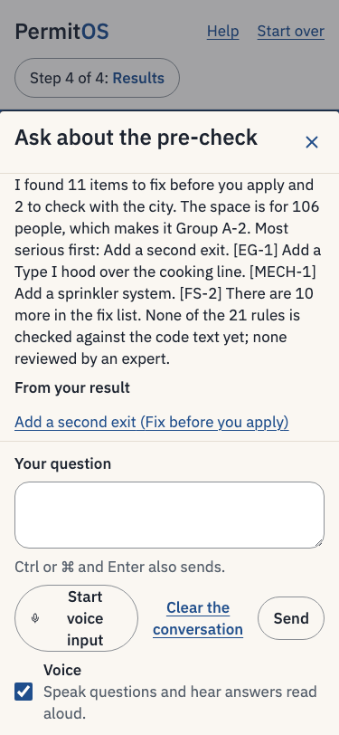
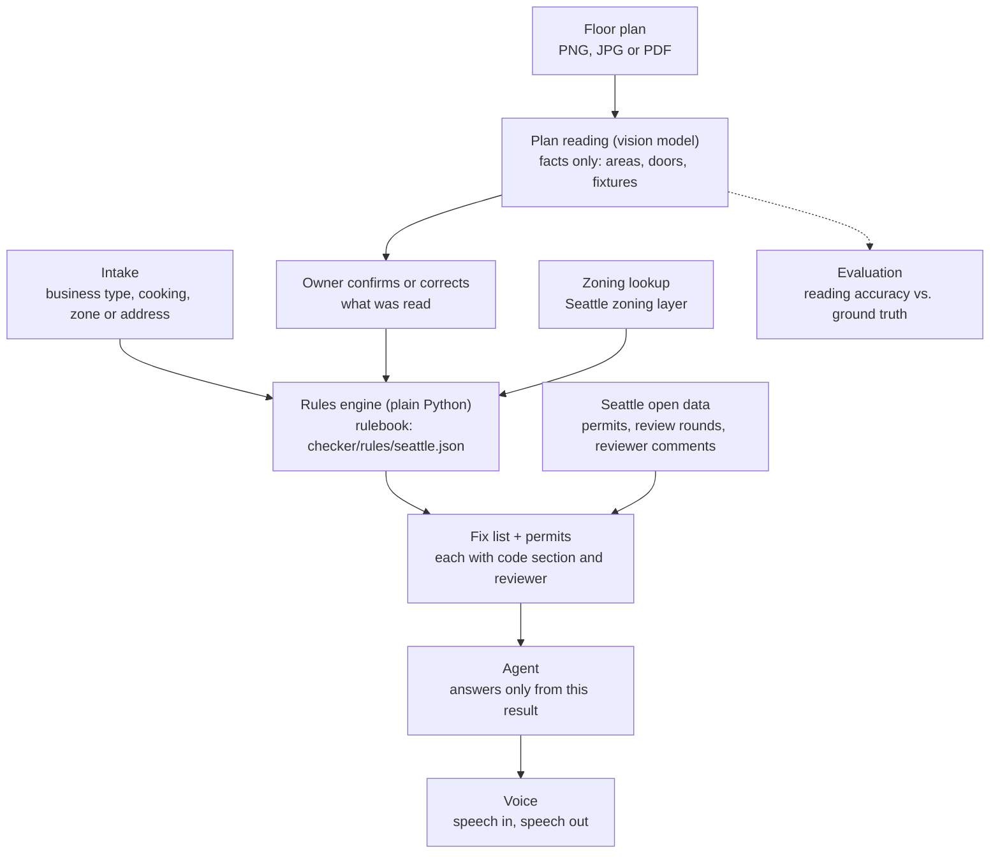

<a id="top"></a>
<h1 align="center">Seattle Permit Pre-Check</h1>

<p align="center">
  
  
  
  <a href="LICENSE"></a>
</p>

<p align="center">
  <a href="https://permitos-five.vercel.app"></a>
</p>

<p align="center">
  PermitOS reads the floor plan for a small business in Seattle, checks it against rules coded from the city's codes, and lists what to fix and which permits to expect before the owner applies.
</p>

<p align="center">
  
</p>

> **Status: prototype.** The rules, the Seattle data pipeline and the website run and are tested. The vision model has now read the three demo plans (21 November 2026), but no real floor plan yet. The live Seattle download ran on 21 November 2026 (1,588 permits, 11,391 review steps, 26,299 reviewer comments). The two local speech models run, but have only been measured on machine-spoken questions. The [status table](#what-is-real-and-what-is-not-yet) says exactly what is real. This is a pre-submission check, not a code determination, and it is not affiliated with the City of Seattle.

## Contents

- [What it does](#what-it-does)
- [Screenshots](#screenshots)
- [What is real and what is not yet](#what-is-real-and-what-is-not-yet)
- [Try it](#try-it)
- [How it works](#how-it-works)
- [Repository map](#repository-map)
- [Design](#design)
- [Websites and keys](#websites-and-keys)
- [What Seattle's data showed](#what-seattles-data-showed)
- [Build phases](#build-phases)
- [Working in this repo](#working-in-this-repo)
- [Before launch](#before-launch)
- [Limits](#limits)
- [Troubleshooting](#troubleshooting)
- [Team](#team)

## What it does

Opening a small business in Seattle means a construction permit, and most plans do not pass the first time: of 656 food-and-drink tenant build-outs since 2019 that went through plan review, 88% needed two or more rounds, and the median time in review was 74 days ([details](#what-seattles-data-showed)). Each round is weeks of rent with no revenue. This prototype:

- **reads the floor plan** with a vision model, which only reports facts (areas, door widths, fixtures) and never judges them,
- **shows what it read** so the owner can correct a misread number before anything is checked,
- **applies coded rules** from the Seattle Building Code for six kinds of business, so every problem traces to one line of a rulebook and one code section,
- **names who catches each problem** in Seattle's review (building-code review, zoning, Fire Department, Public Health),
- **lists the permits and agencies** for that kind of business,
- **quotes Seattle's own review records** for similar projects: rounds, days, and what reviewers comment on,
- **answers questions, typed or spoken**, using only the owner's result.

<p align="right"><a href="#top">back to top ↑</a></p>

## Screenshots

From a local copy of the website with no API key, on the fictional demo café. More screenshots, including the edge
states, are in [`docs/screenshots/design-v3/`](docs/screenshots/design-v3/).

<table>
  <tr>
    <td width="50%" valign="top">
      
      <br><b>Start.</b> What the check is, in four steps, before anything is uploaded.
    </td>
    <td width="50%" valign="top">
      
      <br><b>Plan.</b> Upload a PDF, PNG or JPG. This test server has no key, so it offers the example plans instead.
    </td>
  </tr>
  <tr>
    <td width="50%" valign="top">
      
      <br><b>Answers.</b> The owner sees every value read from the plan and can change it before the check runs.
    </td>
    <td width="50%" valign="top">
      
      <br><b>Results: Fix.</b> Each item says what the plan shows, what to change, and the code section.
    </td>
  </tr>
  <tr>
    <td width="50%" valign="top">
      
      <br><b>Results: Check with the city / No issues found.</b> What the plan can't settle goes to the city, never to a pass.
    </td>
    <td width="50%" valign="top">
      
      <br><b>Ask.</b> The assistant answers from this result only, by typing or by voice, and links to the findings it names.
    </td>
  </tr>
  <tr>
    <td width="50%" valign="top" align="center">
      
      <br><b>Phone: Results.</b>
    </td>
    <td width="50%" valign="top" align="center">
      
      <br><b>Phone: Ask.</b>
    </td>
  </tr>
</table>

<p align="right"><a href="#top">back to top ↑</a></p>

## What is real and what is not yet

| Part | File | Now | Still to do |
| --- | --- | --- | --- |
| Rulebook | `checker/rules/seattle.json` | **Real.** Six business types, 21 rules. Most numbers were read from the 2021 Seattle Building Code PDFs, but **all 21 rules are still `unchecked`**: none is yet transcribed (compared and signed by a person) or reviewed by an expert ([docs/verifying-rules.md](docs/verifying-rules.md)) | Transcribe the foundation rules (OL-0, OCC-1, EG-1), then the rest; record an expert review |
| Rules engine | `checker/rules_engine.py` | **Real and tested** on three demo plans and on each business type | More checks (travel distance, parking, signage) |
| Zoning | `checker/zoning.py` | Logic tested; the live lookup is tested with the network mocked | Run one real address |
| Plan reading | `checker/extract.py` | **The real model has read the three demo plans** (21 November 2026, one run): 103 of 107 facts read correctly. The demo plans are fictional and drawn to be easy to read | **Read a real floor plan** (with permission); accuracy on real drawings is unknown |
| Evaluation | `evaluation/evaluate_extraction.py` | Scoring is real and tested. First results in [reports/extraction_eval.md](reports/extraction_eval.md): of 14 real problems on the two flawed plans, 12 were caught as problems, 2 were flagged to confirm, none missed, no false alarms. One run, three demo plans | Repeat the run to see how much it varies; add more plans |
| Seattle data | `pipeline/` | **The live download has run** (21 November 2026): 1,588 permits, 11,391 review steps, 26,299 reviewer comments, the same counts the city's portal gave on 23 November. Mappers and queries tested | The data is not committed: each computer runs the download itself. Run it again with `--refresh` before quoting numbers |
| Agent | `checker/agent.py` | Template answers work with no key; model path and grounding check tested with the API mocked. One real answer (24 November 2026) came back grounded, in 101 words, and ended on its own. Fixed that day: empty answers (thinking is now off on this call) and answers cut off mid-sentence (the prompt asks for at most 120 words; `max_tokens` is 1,000) ([docs/launch.md](docs/launch.md#budget)) | Try more questions with a key, including follow-ups |
| Voice | `checker/voice.py` | Browser voice and fallbacks tested. **faster-whisper and Kokoro run** on one laptop (macOS, Intel, CPU): 9 of 10 machine-spoken questions came back word for word, under 1 s to speak and under 1 s to transcribe each ([reports/voice_eval.md](reports/voice_eval.md)). A person has used the microphone in Chrome on a local copy, and it works (one person, not measured). The web front end listens on the device where the browser can (Chrome), and otherwise records WebM, MP4 or Ogg for our API ([docs/voice.md](docs/voice.md#the-web-front-end-three-paths)) | **No person has tried voice on the live site yet, in Chrome or Safari** |
| Website | `web/` | **Live at https://permitos-five.vercel.app**, with the API on Fly.io (it sleeps when idle, so the first request can take a few seconds). **Built and tested** against the real API with no key and the demo plans: every page, axe, keyboard and 320 px checks, screenshots ([docs/website_progress.md](docs/website_progress.md)). A static Next.js site; no rules, no key, no model calls (a build guard enforces it) | An uploaded plan read with a key; the Protomaps tiles; a spoken question in Chrome and Safari with faster-whisper installed; testing with business owners |
| Streamlit website | `app/` | **Real.** All five pages, tested headlessly and in a browser | Deploy to a public URL |
| Web API | `api/` | **Tested with the model and the network mocked.** Ten routes under `/api` for the web front end, plus `/api/health`: read a plan, screen zoning, run and store a check, fetch it, both PDFs, ask a question, transcribe a spoken question, delete. It adds no rules; it calls `checker/`. Intake answers accept `null` ("Not sure"), which the rules engine treats as unknown. Docs page at `/docs` (off in production). Launch hardening (`api/security.py`, `api/limits.py`, `tests/test_api_security.py`): security headers, body-size caps, uploads typed by their bytes with picture and PDF limits, per-address rate limits, two daily caps on model calls (plan reads and questions, counted separately so questions never block uploads), optional Turnstile, CORS from `PERMIT_CORS_ORIGIN` only. Packaged by the `Dockerfile`; deployment steps in `docs/launch.md`. The live site's API runs on Fly.io and sleeps when idle | **Read an uploaded plan with a key; try one real address through `/api/zoning`; transcribe a real recording with faster-whisper installed (`/api/transcribe`); build the Docker image and run the smoke test in `docs/launch.md`; call Turnstile's siteverify for real.** No login: a check is reached only by its unguessable link. Known follow-up: reviewer examples in `/ask` (the Streamlit app gives the agent real reviewer comments; the API does not yet) |
| Permit application preparation sheet | `checker/permit_draft.py` | **Real and tested** on the café and salon demo plans. A short sheet (two or three printed pages) gathering what SDCI's published pages say the application asks for, filled from the result where it can be; the rest is marked for the applicant. A preparation aid: it does not fill in the city's form | Field list read from city pages on 20-21 November 2026, one of them dated 2016 ([docs/permit_draft.md](docs/permit_draft.md)): **check it against the portal itself** |
| PDF downloads | `checker/pdf.py` | **Real and tested.** The owner downloads the report and the preparation sheet as PDFs (US Letter, page numbers, black and white). The command line writes `report.pdf` next to `report.md` and `report.json`. Page 1 of each was rendered and checked by eye for accents, wrapping and margins | Print one on paper; open one in a screen reader |

Unfinished parts say `STATUS:` in their docstring. `grep -rn "STATUS:" checker pipeline evaluation` lists them.

<p align="right"><a href="#top">back to top ↑</a></p>

## Try it

The quickest way is the live demo: https://permitos-five.vercel.app. The API behind it sleeps when idle, so the first
request can take a few seconds. To run it yourself:

### Install

Python 3.12 or newer, from the repository root:

```bash
python3 -m venv .venv
source .venv/bin/activate            # Windows (PowerShell): .venv\Scripts\Activate.ps1
python -m pip install -r requirements.txt
```

The web front end in `web/` also needs Node 22 (see [web/README.md](web/README.md)). On the project's Intel Mac, Node is
installed in `~/.local/node-v22.23.5-darwin-x64/bin`. If `node` or `npm` is not found, add it to the PATH for that
terminal: `export PATH="$HOME/.local/node-v22.23.5-darwin-x64/bin:$PATH"`.

### Run the Streamlit website

It works with no key and no internet, on the demo plans:

```bash
python -m streamlit run app/streamlit_app.py
```

Pick a demo plan, press **Read the plan**, then **Run the check**. Start with *Café with planted problems*, then switch to the salon to see a different business type.

### Run the web API

For a front end; the Streamlit website does not need it:

```bash
uvicorn api.main:app --reload
```

Then open http://localhost:8000/docs to see and try every route. It works with no key on the demo plans. Only a browser page served from `http://localhost:3000` may call it; change that with `PERMIT_CORS_ORIGIN`.

What the API keeps: **uploaded plans are not saved.** A plan file is read and deleted straight away. **A check is stored**: the facts read from the plan, the answers about the business, the address or zone if one was given, and the result. It is kept for 30 days (`PERMIT_CHECK_DAYS`) in `data/checks.sqlite` on the server, or until it is deleted with `DELETE /api/checks/{id}`. The Claude API key stays on the server and is never sent to the browser.

### Run the tests

```bash
python -m pytest
```

### Download Seattle's review records

Internet, no key, a few minutes. After this, reports and the data page show real numbers:

```bash
python -m pipeline.run_pipeline --seattle
```

### Read a plan with the vision model

This needs a key: copy `.env.example` to `.env` and fill in `ANTHROPIC_API_KEY`.

```bash
python -m evaluation.evaluate_extraction --vision      # scores the model on all three demo plans
python -m checker.audit demo/flawed_plan.png --business cafe_restaurant --cooking --zoning "NC2-55 (M)"
```

### Turn on spoken questions

Optional; downloads about 500 MB of speech models on first use:

```bash
python -m pip install -r requirements-voice.txt
PERMIT_TTS=kokoro python -m checker.voice               # speaks a sentence, prints what it heard back
python -m evaluation.evaluate_voice                     # ten spoken questions -> reports/voice_eval.md
PERMIT_TTS=kokoro python -m streamlit run app/streamlit_app.py
```

Without the install, questions are typed and the browser reads the answers aloud. Without `PERMIT_TTS=kokoro`, the microphone works and the browser's voice reads the answers.

### ffmpeg

For the web API's `/api/transcribe`: browsers record WebM, MP4 or Ogg, and the API converts each to WAV
with ffmpeg before faster-whisper reads it. Install it with `brew install ffmpeg` (macOS on Apple Silicon), `sudo
apt-get install ffmpeg` (Debian, Ubuntu) or `winget install ffmpeg` (Windows), so that `ffmpeg` is on the PATH.

On an Intel Mac, Homebrew no longer supports the machine, so install ffmpeg into the project's `.venv` instead. With the
`.venv` active, from the repository root:

```bash
pip install imageio-ffmpeg
ln -sf "$(python -c 'import imageio_ffmpeg; print(imageio_ffmpeg.get_ffmpeg_exe())')" .venv/bin/ffmpeg
ffmpeg -version                      # prints the version: ffmpeg is on the PATH while the .venv is active
```

This puts ffmpeg on the PATH only while the `.venv` is active, which is when the API and the tests run. Without it,
`/api/meta` reports `speech_to_text: false` and the website records nothing; browsers that can turn speech into text
on the device (recent Chrome) still take spoken questions, because their audio never reaches the server. The
recording is kept in a private temporary folder only while ffmpeg converts it, then deleted. The API tests generate
their WebM, MP4 and Ogg clips with ffmpeg, and skip those tests if it is missing.

<p align="right"><a href="#top">back to top ↑</a></p>

## How it works



Three ideas hold it together:

- **The model reads; code decides.** A language model is good at reading a drawing and bad at being consistently right about code numbers. So the model extracts facts into a fixed format, and compliance is decided by rules you can read in one JSON file.
- **Show the reading.** The owner sees what was read and can fix it. The check uses those numbers, not the drawing.
- **The agent is grounded, not trained.** Nothing here is fine-tuned. The agent is given the owner's result (and, once the data is downloaded, real reviewer comments on the same code chapters) and must answer from that. An answer that cites a rule or code section the result does not contain is discarded and replaced by a fixed template.

<p align="right"><a href="#top">back to top ↑</a></p>

## Repository map

```
checker/                  the engine
├── rules/seattle.json    the rulebook: six business types, code numbers, zones, permits (start here)
├── extract.py            vision: floor plan -> facts (the only place a model reads the drawing)
├── rules_engine.py       facts + rulebook -> findings and permits (no model)
├── zoning.py             address or zone -> allowed, needs review, or not allowed, per business type
├── audit.py              runs the steps above in order; also the command-line tool
├── agent.py              answers questions about one result, with a grounding check
├── permit_draft.py       one result -> the permit application preparation sheet (adds no rules)
├── pdf.py                the report and the preparation sheet as printable PDFs (layout only)
├── fonts/                DejaVu Sans, embedded in the PDFs, with its licence (Bitstream Vera licence)
└── voice.py              speech to text and text to speech around the agent
pipeline/                 Seattle open data
├── seattle.py            download and map permits, plan reviews, reviewer comments
├── classify.py           sorts permits into food_drink, salon, fitness, retail by keyword
├── db.py  schema.py      SQLite storage (data/permits.sqlite)
├── query.py              rounds, days, who sends plans back, what comments are about
└── run_pipeline.py       command-line runner
api/                      the web API for a front end (FastAPI): main.py routes, schemas.py the contract,
                          store.py stored checks, uploads.py upload checks, geo.py zone outline for a map
app/                      the Streamlit website
├── streamlit_app.py      entrypoint: header and navigation
├── app_common.py         page paths, session keys, cached loads, Limits and About text
└── pages_app/            check (the main page), seattle_data, evidence, limits, about
evaluation/               evaluate_extraction.py: how accurately the model reads a plan; evaluate_voice.py: spoken questions
demo/                     three fictional plans, their ground truth, cases.json, make_plans.py
data/raw/                 downloads go here (not committed)
reports/                  evaluation output for the slides
docs/                     rulebook status, data sources, demo script, voice options,
                          permit_draft.md: the city source for each field on the preparation sheet
tests/                    one file per part, plus a headless test of the website
CLAUDE.md                 project rules for Claude Code
```

<p align="right"><a href="#top">back to top ↑</a></p>

## Design

How PermitOS looks and talks, and why:

- [`DESIGN.md`](DESIGN.md): colours, type, shapes, zones, status icons and components, with the reason for each.
- [`CONTENT.md`](CONTENT.md): the writing rules, with before and after examples.
- [`docs/design-story.md`](docs/design-story.md): the story from the first version to this one, mistakes included.
- [`docs/decisions.md`](docs/decisions.md): the decision log, newest first, with what was rejected.
- [`docs/design_checklist.md`](docs/design_checklist.md): the pass/fail checklist each version is scored against.
- Screenshots of the built site: [`docs/screenshots/design-v3/`](docs/screenshots/design-v3/). The Figma file:
  https://www.figma.com/design/PVw8XgzSLPe2q9TR8mbbhj

<p align="right"><a href="#top">back to top ↑</a></p>

## Websites and keys

Only one key is needed, and only for reading uploaded plans and for model-written answers. Full list with what each is used for: [docs/data_sources.md](docs/data_sources.md).

| Service | Host | Key? |
| --- | --- | --- |
| Claude API (plan reading, agent) | `api.anthropic.com` | **Yes**: `ANTHROPIC_API_KEY` |
| Seattle open data (permits, reviews, comments) | `cos-data.seattle.gov` | No. Optional free app token |
| Seattle zoning layer | `services.arcgis.com` | No |
| US Census geocoder (address to point) | `geocoding.geo.census.gov` | No |
| Speech models, optional | `huggingface.co` (Whisper), `github.com` (Kokoro files) | No (public models) |

<p align="right"><a href="#top">back to top ↑</a></p>

## What Seattle's data showed

Source: the pipeline's download of Seattle's open data on 21 November 2026. Tenant build-outs (additions and alterations) that went through plan review:

| Business type | Permits | Needed two or more review rounds | Median days in review |
|---|---|---|---|
| Food and drink | 656 | 88% | 74 |
| Retail | 391 | 86% | 63 |
| Gym and fitness | 67 | 81% | 62.5 |
| Salon | 43 | 79% | 43 |

- In round 1, for food and drink, the building-code review sent back most permits (Ordinance: 182 sent back, 31 approved). Zoning approved most (203 sent back, 458 approved).

The points below come from an earlier query of the city's portal on 20 November 2026, using its text search for "restaurant". They have not been re-run through the pipeline.

- One real case, permit 6998648-CN: an office converted to a coffee shop, a $60,000 project, spent 175 days in plan review over three rounds, 77 of them waiting on the applicant's corrections.
- The reviewer-comments dataset is a sample: about 26,300 comments on 707 permits, 2022 to 2025.

<p align="right"><a href="#top">back to top ↑</a></p>

## Build phases

- [x] **Phase 0: Setup.** Layout, environment, `.gitignore`, `CLAUDE.md`, tests on GitHub
- [x] **Phase 1: Rules.** Rulebook for six business types, rules engine, zoning, three demo plans
- [x] **Phase 2: Seattle data.** Download, database, queries (live download run on 21 November 2026)
- [x] **Phase 3: Website.** Five pages, editable reading, results, PDF downloads
- [ ] **Phase 4: Plan reading with the model.** Run `--vision`, record the accuracy table, fix the prompt where it misreads
- [ ] **Phase 5: Agent and voice with real models.** Try the agent with a key; ~~try the two speech models~~ (done, see [reports/voice_eval.md](reports/voice_eval.md)); ~~try the microphone with a real voice~~ (works in Chrome; Safari recording does not work yet)
- [ ] **Phase 6: More plans.** A retail and a gym demo plan, and one real (permission given) plan
- [x] **Phase 7: Permit application preparation sheet.** A short sheet gathering what the city's application asks for, filled from the result where it can be; a preparation aid, not the city's form ([docs/permit_draft.md](docs/permit_draft.md))
- [ ] **Phase 8: Demo and write-up.** Results table, limits, slides ([docs/demo_script.md](docs/demo_script.md))

Phase 4 is the evidence judges will ask for. If time runs short, cut from the bottom.

<p align="right"><a href="#top">back to top ↑</a></p>

## Working in this repo

- **One branch per phase or part**, merged through a pull request. The template has a short checklist.
- **The rulebook is the source of truth.** Change a number in `checker/rules/seattle.json`, never in Python. Say where the number came from in `_meta`.
- **The app holds no rules.** It calls `checker/` and `pipeline/` and displays what comes back.
- **Tests pass before merging.** `python -m pytest` locally; GitHub runs the same on every pull request.
- **Keys go in `.env`**, never in code. `.env.example` lists the names.
- **Any number you report says what data it came from.**
- **No real floor plans or personal data in the repository.** The demo plans are invented.

<p align="right"><a href="#top">back to top ↑</a></p>

## Before launch

Open items that must be done before real owners use the site. Each is a GitHub issue labelled
[before launch](https://github.com/RenzoRamirez26/seattle-permit-checker/issues?q=label%3A%22before+launch%22):

- [ ] Real-key test: a real plan, a real Seattle address, and the assistant by typing and by voice in Chrome and Safari (#31).
- [ ] Transcribe the foundation rules (OL-0, OCC-1, EG-1), then the other 18 ([docs/verifying-rules.md](docs/verifying-rules.md)) (#32).
- [ ] An expert review, recorded as `reviewed` (#33).
- [ ] A usability test with five owners (#34).
- [ ] A trademark check on "PermitOS" (#35).
- [ ] Export Figma v1 to v3 to `docs/screenshots/figma/` (#36).
- [ ] Check whether "Nothing to fix before you apply" appears twice on a results page (#37).

<p align="right"><a href="#top">back to top ↑</a></p>

## Limits

- **Not a code determination.** A licensed design professional and the plan reviewer decide what complies.
- **A short list of checks.** Occupant load, exits, doors, aisles, restrooms, sprinklers, kitchen hood and sinks, zoning. A real review covers far more.
- **Seattle only**, 2021 Seattle codes. The 2024 editions arrive no sooner than May 2027.
- **No rule is checked against the code text by a person yet.** Every rule has a level (unchecked, transcribed, reviewed); all 21 are unchecked. See [docs/verifying-rules.md](docs/verifying-rules.md).
- **Demo plans are fictional** and drawn to be easy to read. Real drawings are harder, and reading accuracy on them is unknown.
- **The permit categories are keyword matches** on the city's descriptions, so some permits are missed or mislabelled.
- **Reviewer names are in the city's data and are not stored.**

<p align="right"><a href="#top">back to top ↑</a></p>

## Troubleshooting

<details>
<summary><b><code>No module named 'checker'</code> (or <code>'app'</code>, <code>'pipeline'</code>)</b></summary>

Run every command from the repository root. From anywhere else, Python cannot find the packages.

</details>

<details>
<summary><b>The Seattle download fails or stops part-way</b></summary>

Run it again: finished files are kept and skipped. If the portal throttles you, get a free app token at data.seattle.gov and put it in `.env` as `SEATTLE_APP_TOKEN`. To force a fresh download add `--refresh`.

</details>

<details>
<summary><b>No sound when the agent answers</b></summary>

Press <b>Play answer</b> under the answer: some browsers block speech that a click did not start. The browser voice needs Chrome, Edge or Safari.

</details>

<details>
<summary><b>The microphone box does not appear</b></summary>

It appears only when `faster-whisper` is installed (`requirements-voice.txt`), and the browser must be allowed to use the microphone. The first recording downloads the speech model, which takes a minute.

</details>

<details>
<summary><b>A spoken question does not get through in Safari</b></summary>

Use Chrome for spoken questions. In Safari, typed questions and spoken answers work, but a question recorded with the microphone box does not reach the agent yet. This is a known issue, not yet fixed: see [docs/voice.md](docs/voice.md#known-issues).

</details>

<p align="right"><a href="#top">back to top ↑</a></p>

## Team

We all contributed equally.

| Name | GitHub | Contribution |
| --- | --- | --- |
| Lorenzo | [RenzoRamirez26](https://github.com/RenzoRamirez26) | Coordinated the team across design, model and website; wrote the design guidelines for language, colour and space; worked on the model. |
| Maria Gomez Jacome | [cjgomez14](https://github.com/cjgomez14) | Built the model and parts of the website's backend. |
| Orlando Hernandez | [Orlando-Hernandez](https://github.com/Orlando-Hernandez) | Built most of the website, shaped parts of its design, and scoped the features planned next. |
| Alba Benedito | [albabc2020-hub](https://github.com/albabc2020-hub) | Built voice input, shaped the website's layout, and wrote the language guidelines Claude follows. |

<p align="right"><a href="#top">back to top ↑</a></p>
